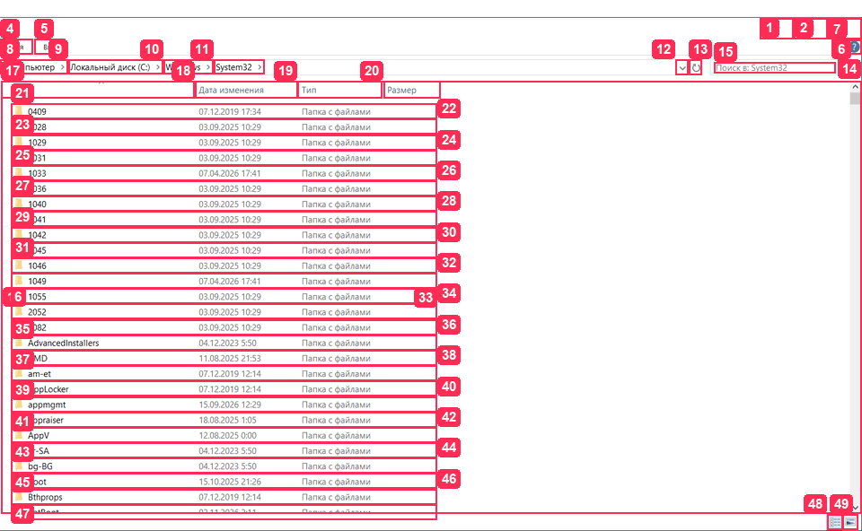

# som-window-mcp

**Read-only eyes for Windows desktop UI.** Let an AI agent see a window —
including one covered by other windows — without guessing from full-screen
pixels, and without giving it a mouse.

> Status: **v0.3** — five read-only tools: window list, accessibility tree,
> single-element inspection, plain capture, and the numbered Set-of-Mark overlay.



*One window, captured while it was covered by another. The marks come from the
accessibility tree, not from OCR, so every number maps to an exact screen rect.*

## Why

When you ask an agent to help with a desktop app, it has two bad options today:

1. **Screenshot the whole screen.** Expensive in tokens, and it captures your
   private windows along with the target one. If the app is behind your
   terminal, the agent cannot see it at all.
2. **Install a full desktop clicker.** That hands the model a mouse and a
   keyboard. Any text on screen can then talk the model into pressing `Win+R`
   and running something. It also tends to hang on blocked Windows calls.

This server takes a third path: **look, never touch.** It reads the real Windows
accessibility tree for structure, and `PrintWindow` for pixels, so a covered
window still captures cleanly and only that window is in the image.

## Tools

| Tool | What it returns |
|---|---|
| `list_windows` | Visible windows: `hwnd`, process, physical-pixel rect, whether the window is covered (`occluded`), whether it needs an elevated server (`elevated`) |
| `get_ui_tree` | Compact text list of interactive elements — path, type, name, automation id, screen rect — with zoomable `max_depth` / `max_nodes` |
| `inspect_element` | Full content of one element by path: value, bounded text, and a summary of its immediate children |
| `capture_window` | One window's pixels, even while covered, plus the screen position of image pixel `(0,0)` |
| `capture_som` | The same capture with a **numbered box on every interactive element**, plus a legend that maps each number to a real screen rect |

There is no click, no typing, no mouse movement, and no code execution anywhere
in this package.

## Set-of-Mark

`capture_som` draws a numbered box on each interactive control. The boxes come
from the accessibility tree, not from OCR or a detector, so they are pixel-exact
and the legend carries real coordinates:

```text
 7   0.4.1  Button  "Открыть SDS"  @450,320 90x28
```

A vision model answers "7" instead of estimating a pixel; a clicker uses the
rect and never looks at the image at all. Numbering follows reading order
(top-to-bottom, left-to-right), and the tree is walked breadth-first so a fixed
node budget reaches toolbars and lists before it disappears into one menu.

Three filters keep the overlay readable:

- **duplicates** — Windows Terminal exposes its caption buttons twice; overlapping
  controls of similar size are collapsed to the named one
- **cells inside rows** — Explorer reports four column values per list row; the
  row is marked, its cells are not
- **budget** — `max_marks` caps the count, and badge placement avoids collisions
  (verified: zero overlapping badges on a 60-mark Explorer window)


## Requirements

- Windows 10/11 (x64)
- Python 3.10+

## Install

Not on PyPI yet, so install from the repository:

```sh
uv tool install git+https://github.com/Nikita-Pugach/som-window-mcp
```

With pip instead:

```sh
pip install "git+https://github.com/Nikita-Pugach/som-window-mcp"
```

`uv tool install` places the `som-window-mcp` binary in `~/.local/bin`. If the
command is not found afterwards, run `uv tool update-shell` once.

From a clone, for development:

```sh
git clone https://github.com/Nikita-Pugach/som-window-mcp
cd som-window-mcp
uv tool install .
```

## Configure

### OpenCode

```sh
opencode mcp add som-window --global -- som-window-mcp
```

Or by hand in `opencode.jsonc`:

```jsonc
{
  "$schema": "https://opencode.ai/config.json",
  "mcp": {
    "servers": {
      "som-window": {
        "type": "local",
        "command": ["som-window-mcp"],
      },
    },
  },
}
```

### Claude Code

```sh
claude mcp add som-window -- som-window-mcp
```

### Any other MCP client

```json
{
  "mcpServers": {
    "som-window": {
      "command": "som-window-mcp"
    }
  }
}
```

Running from a checkout instead of an installed package:

```json
{
  "mcpServers": {
    "som-window": {
      "command": "python",
      "args": ["-m", "som_window_mcp.server"],
      "env": { "PYTHONPATH": "C:\\dev\\som-window-mcp\\src" }
    }
  }
}
```

## Coordinate contract

Everything is in **physical screen pixels**, and the server sets
`PER_MONITOR_AWARE_V2` at startup, so coordinates match the screen on 100%,
125%, 150% and mixed-DPI multi-monitor setups.

`capture_window` reports `origin`: the screen coordinate of image pixel `(0,0)`.

```text
screen_x = origin_x + pixel_x
screen_y = origin_y + pixel_y
```

That is what a clicker needs, and it is the reason the capture is cropped by
`DWMWA_EXTENDED_FRAME_BOUNDS`: without the crop every image carries a 9 px black
frame from the invisible DWM resize border and every coordinate is off.

## Known limitations

Measured, not guessed — see [`docs/uia-matrix.md`](docs/uia-matrix.md) for the
raw numbers.

| Case | Behaviour |
|---|---|
| Elevated window, non-elevated server | Windows blocks UIA across integrity levels. The tool says so explicitly instead of returning an empty tree. Run the server elevated to read it. |
| Chrome, VS Code, Slack, Discord (Chromium/Electron) | No UI tree at all unless the app was started with `--force-renderer-accessibility` (8 nodes vs 173 measured). Screenshots work either way. |
| Qt / Delphi apps | Partial or absent UIA tree. Screenshots still work. |
| Minimised windows, some GPU surfaces | `PrintWindow` returns a blank frame; this is detected and reported instead of returning a useless image. |
| Dense windows | About 2.5 ms per UIA node. Use `max_nodes`; a 4000-node walk takes ~10 s. |

Read-only still means "sees your screen": captures are sent to your model
provider. Use the window list to target a specific window, and keep password
managers and banking apps out of the loop.

## How it works

- `win32.py` — DPI awareness, window enumeration (DWM cloaked filter),
  `PrintWindow(PW_RENDERFULLCONTENT)`, `BGRX` decode to dodge the zero-alpha bug.
- `uia_worker.py` — UI Automation runs in a **separate process**; a blocked COM
  call cannot be cancelled by a thread timeout, so the parent kills the process.
- `worker.py` — persistent worker with hard timeout and transparent respawn
  (cold-importing `uiautomation` costs 1–2 s per call, so it stays alive).
- `inspector.py` — window resolution and terse formatting. Ambiguous matches are
  an error, never a silent first hit.
- `overlay.py` — Set-of-Mark: de-duplication, containment suppression, reading
  order, collision-free badge placement.
- `capture.py` — blank-frame detection, downscale, smaller of PNG/JPEG.

## Roadmap

- `0.4` — optional actions (`--enable-actions`) in a **separate** package, so
  this core stays provably read-only
- `0.5` — publish to PyPI, make `uvx som-window-mcp` the install line

## Development

```sh
pip install -e ".[dev]"
pytest
```

The unit tests cover window resolution, formatting, overlay selection and
encoding. They do not touch Win32, so they run in a quarter of a second.

## License

MIT
